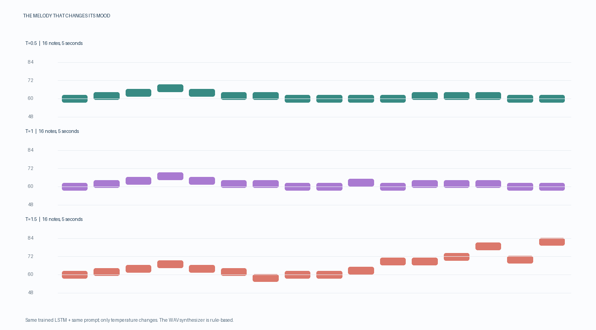

# 🎵 The Melody That Changes Its Mood

An **LSTM next-note model** that generates melodies, and a controlled experiment showing how **sampling temperature** alone changes a melody's character, from calm and repetitive to bold and unpredictable.

> Same trained model · same opening notes · same random seed · **only the temperature changes.**



---

## 📌 Overview

Music is a sequence: each note depends on the ones before it. This project treats melody generation like next-word prediction:

1. Melodies are converted into **tokens** (MIDI pitches 48–84, plus `BOS`/`EOS` markers, 39 tokens in total).
2. A 2-layer **LSTM** is trained with **teacher forcing** and **cross-entropy loss** to predict the next note.
3. The trained model continues a fixed 4-note opening (`60-62-64-67`) at different **temperatures**.
4. Each melody is turned into a 5-second **WAV**, a comparison **plot**, and a **CSV**.

**This is not a GAN.** It is a single recurrent network trained to predict the next token.

---

## 🧠 Model architecture

```
Note tokens → Embedding(39, 32) → LSTM(128) × 2 layers → Linear(128, 39) → Softmax
```

| Component | Detail |
|---|---|
| Vocabulary | 37 pitches (MIDI 48–84) + BOS + EOS = 39 |
| Training data | 400 procedural 20-note melodies (3 pentatonic scales) |
| Loss | Cross-entropy (padding ignored) |
| Optimizer | Adam, lr = 0.002, batch 32, gradient clipping 1.0 |
| Epochs | 12 |
| Parameters | ~221K |

### Temperature sampling: the key idea

```python
probs = torch.softmax(logits / temperature, dim=0)
next_note = torch.multinomial(probs, 1)
```

- **Low τ (e.g. 0.5):** sharper probabilities, so the model plays it safe and the melody is repetitive.
- **High τ (e.g. 1.5):** flatter probabilities, so unlikely notes get a chance and the melody is adventurous.

---

## 📊 Results

### Training

| Metric | Epoch 1 | Epoch 12 |
|---|---|---|
| Cross-entropy | 3.42 | **1.74** |
| Perplexity | 30.7 | **5.7** |

Perplexity fell from roughly 30 candidate notes to roughly 6, so the model learned the melodic patterns.

### Temperature comparison (seed 7)

| Temperature | Behaviour |
|---|---|
| 0.5 | Stays around middle C (60–62), highly repetitive |
| 1.0 | Mostly stable, with an occasional surprise note |
| 1.5 | Wide range, climbing toward the high 70s–80s |

### My extensions

- **Temperature sweep (0.1 → 2.0):** at 0.1 the melody barely moves; at 2.0 it is close to random. Temperature behaves like a smooth dial. Outputs are in `outputs/my_temperature_sweep/`.
- **Different seed (21):** the actual notes change, but the pattern (low τ = safe, high τ = varied) holds, so the effect comes from temperature, not one lucky seed. Outputs are in `outputs/my_seed_21/`.

---

## 🛠 Debugging and fixes

The starter kit did not run out of the box. Fixes made:

- **Environment:** PyTorch was missing; set up an isolated virtual environment.
- **Dependencies:** added `jupyter` and `ipykernel` to `requirements.txt` so the guided notebook runs.
- **Plot bug:** note bars were drawn *below* their pitch line; centred each bar on its pitch.
- **Plot sizing:** the canvas was fixed at 3 rows, so extra temperatures were cut off. The height now scales with the number of temperatures.
- Removed an unused import.

---

## 🚀 Quick start

```bash
python3 -m venv .venv
source .venv/bin/activate          # Windows: .venv\Scripts\activate
pip install -r requirements.txt

# 1. Pipeline check
python src/project.py --mode smoke-test

# 2. Train
python src/project.py --mode train --epochs 12 --examples 400 --output-dir outputs/training

# 3. Compare temperatures
python src/project.py --mode generate --checkpoint outputs/training/melody_lstm.pt \
  --temperatures 0.5,1.0,1.5 --seed 7 --output-dir outputs/comparison
```

Runs on CPU (tested on a MacBook Air M2); training takes under a minute.

---

## 📁 Project structure

```
├── src/project.py                    # Data, model, training, sampling, audio, plotting, CLI
├── Project_10_Guided_Notebook.ipynb  # Step-by-step notebook
├── requirements.txt
└── outputs/
    ├── training/                     # melody_lstm.pt, training_history.csv
    ├── comparison/                   # WAVs, plot, CSV, run_metadata.json
    ├── my_temperature_sweep/         # Extension: τ = 0.1 → 2.0
    └── my_seed_21/                   # Extension: different seed
```

---

## ⚠️ Limitations

- "Mood" is a listening impression; the model has **no emotion labels**.
- Notes all have the **same duration**, so there is no rhythm, dynamics or timbre.
- Training data is **procedurally generated**, not real songs.
- Audio comes from a simple **sine-wave synthesiser**, not neural audio.
- A low loss does not by itself mean appealing music.

---

## 🧰 Tech stack

Python · PyTorch · NumPy · Pillow · Jupyter
